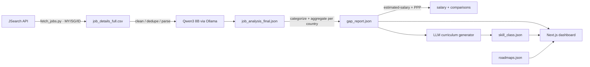

# UDiff: University Diff

    

**Bridging the gap between Academic Curricula and Industry Reality.**

UDiff is an end-to-end project that fetches live job-market data for **Malaysia, Singapore and Indonesia**, uses an LLM to extract the skills employers demand, and visualises the "gap" between what universities teach and what companies actually hire for.

> ⚠️ **Status: working prototype, pending web polish.** The pipeline is complete
> (data enrichment + SEA expansion, Oct 2026); the dashboard still needs to consume the
> country-nested schema (milestone M6). See [`docs/Milestones and Logs.md`](docs/Milestones%20and%20Logs.md).

**Docs:** [`docs/UDiff.md`](docs/UDiff.md) (what it is) · [`docs/Tech Stack.md`](docs/Tech%20Stack.md) (how it's built) · [`docs/Milestones and Logs.md`](docs/Milestones%20and%20Logs.md) (plan + logs)

## 🔗 Live site
[Have a look for yourself!](https://udiff-web.vercel.app/)

## 🧭 How it works



- **Data side (`pipeline/`)** — Python. Fetches postings from the **JSearch API** (OpenWebNinja); pandas cleans/dedupes; a local **Qwen3 8B** (Ollama) extracts hard/soft skills, technical context, and experience level; pandas aggregates a per-country, per-role gap report; JSearch `/estimated-salary` adds attributed pay bands (nominal MYR + PPP-adjusted MYR).
- **Web side (repo root)** — Next.js 16 / React 19 / TypeScript / Tailwind 4, with Recharts and shadcn/ui, deployed on Vercel.

## 🚀 Features

### 1. Market Gap Dashboard
- **Visualization:** interactive bar charts and treemaps (Recharts) of the most in-demand hard skills and technical contexts.
- **Smart Filtering:** segment by role (Backend, AI, Security, …) and seniority (Junior, Mid, Senior).
- **Focus Mode:** interactive "dim & focus" UX to highlight key data points.
- **Multi-country:** Malaysia, Singapore, Indonesia, with cross-country skill-gap and salary comparisons.


### 2. Gamified Career Roadmaps
- A "tech tree" style roadmap for 15+ career paths (foundation → core → advanced), with phase-locking and persisted local progress.


### 3. Curriculum Gap Analyzer (Beta)
- Client-side keyword matcher that scans a syllabus against market demand using a pre-computed skill/curriculum dictionary (`skill_class.json`, per country).


## 📦 Getting started

### Web app
```bash
npm install
npm run dev        # http://localhost:3000
```

### Data pipeline
```bash
# requires Python 3.x, Ollama running 'qwen3:8b', and JSEARCH_API_KEY in pipeline/.env
pip install -r pipeline/requirements.txt
python pipeline/src/pipeline.py                 # fetch -> extract -> analyze -> salary -> compare -> curriculum -> sync
python pipeline/src/pipeline.py --skip fetch    # reuse existing data
python pipeline/src/pipeline.py --list          # list the steps
```
> Paths/settings live in `pipeline/src/config.py`; each step streams to
> `pipeline/pipeline_log.log`, and API/LLM calls also go to `pipeline/logs/{api,gpu}.log`.
> `pipeline/data/ppp.json` / `fx.json` are hand-filled, dated reference tables.

## 📂 Project structure

```
.
├── docs/                     # UDiff.md, Tech Stack.md, Milestones and Logs.md
├── pipeline/                 # Python data pipeline
│   ├── src/                  # config, fetch_jobs, processor, analyzer, salary_estimate,
│   │                         # comparisons, curriculum_generation, companies, locations,
│   │                         # sync_web_data, pipeline (orchestrator)
│   ├── data/
│   │   ├── raw/ interim/ output/
│   │   └── ppp.json fx.json  # dated static reference tables
│   ├── logs/                 # api.log, gpu.log (gitignored)
│   └── requirements.txt
├── src/                      # Next.js app (app router, components, data, types)
├── public/                   # static assets + screenshots
└── README.md
```

## 🛠️ Tech stack

- **Data:** Python, pandas, stdlib `urllib` (JSearch API), Ollama (Qwen3 8B)
- **Web:** Next.js 16, React 19, TypeScript, Tailwind CSS 4, shadcn/ui, Recharts
- **Deploy:** Vercel

## 🔮 Roadmap

See [`docs/Milestones and Logs.md`](docs/Milestones%20and%20Logs.md). Pipeline milestones
(M0–M7) are done; next is **M6** (web cleanup + consume the country-nested schema) and the
design revamp (M9–M11).

## 📄 License

MIT (see `LICENSE`).
