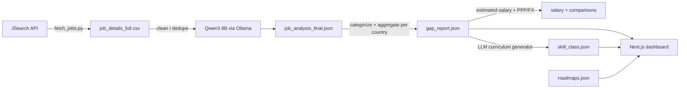

# UDiff — University Diff

**Measuring the gap between university curricula and the tech job market.**

UDiff fetches live job postings for **Malaysia, Singapore and Indonesia**, uses a local LLM to
extract the skills employers actually ask for, and presents the result as an interactive web
dashboard — the skills, salary bands and hiring spread behind each role, plus a curriculum checker
that scores a syllabus against market demand.

Live site: **https://udiff-web.vercel.app**

## Features

- **Market dashboard** — in-demand hard skills, technical contexts, soft skills, experience split,
  salary bands, hiring locations and top companies, per role and experience level, with a country
  switcher (Malaysia / Singapore / Indonesia).
- **Compare markets** — skill gaps and salary deltas, Malaysia vs Singapore and Indonesia.
- **Career roadmaps** — phase-locked learning paths for 15+ roles, with progress saved in your browser.
- **Curriculum checker** — paste a syllabus and see which in-demand skills it covers and which it misses.
- **Observed salary mentions** — text-mined pay signals from ad copy, per market.
- **Methodology and privacy** — how the data is produced, its limits, and what the site does and
  does not collect.

## How it works

Two halves, decoupled by JSON: a Python **data pipeline** that writes the files, and a **Next.js web
app** that reads them.



- **Pipeline (`pipeline/`)** — Python. Fetches postings from the **JSearch API** (OpenWebNinja),
  cleans and de-duplicates them, extracts structured skills with a local **Qwen3 8B** model served by
  **Ollama**, aggregates a per-country gap report, adds attributed salary bands (nominal MYR and
  PPP-adjusted MYR), compares every market against Malaysia, and generates a skill-to-course dictionary.
- **Web (repo root `src/`)** — Next.js 16 / React 19 / TypeScript / Tailwind CSS 4, using Recharts,
  shadcn/ui and lucide-react, deployed on Vercel.

## Getting started

### Web app

```bash
npm install
npm run dev      # http://localhost:3000
npm run build     # production build
npm run lint      # eslint
```

### Data pipeline

Requires **Python 3.x**, a **JSearch API key**, and a **GPU running Ollama with `qwen3:8b`** (the
local extraction model).

```bash
cp pipeline/.env.example pipeline/.env    # then set JSEARCH_API_KEY
pip install -r pipeline/requirements.txt

python pipeline/src/pipeline.py                       # full run
python pipeline/src/pipeline.py --skip fetch          # reuse existing data
python pipeline/src/pipeline.py --list                # list the steps
```

Steps: `fetch → extract → analyze → salary → compare → curriculum → sync`. Paths and settings live in
`pipeline/src/config.py`. Each step streams to stdout (and `pipeline/pipeline_log.log`); API calls and
LLM calls also go to `pipeline/logs/{api,gpu}.log`. `pipeline/data/ppp.json` and `fx.json` are dated,
hand-filled reference tables.

## Project structure

```
.
├── pipeline/                 # Python data pipeline
│   ├── src/                  # config, fetch_jobs, processor, analyzer, salary_estimate,
│   │                         # comparisons, curriculum_generation, companies, locations,
│   │                         # sync_web_data, pipeline (orchestrator) + dev utilities
│   ├── data/                 # raw/  interim/  output/  + ppp.json, fx.json
│   ├── logs/                 # api.log, gpu.log (gitignored)
│   ├── requirements.txt
│   └── README.md
├── src/                      # Next.js app
│   ├── app/                  # routes: /, /dashboard, /compare, /curriculum,
│   │                         #         /methodology, /privacy, /roadmap
│   ├── components/           # AppShell + dashboard cards + ui primitives
│   ├── data/                 # gap_report.json, skill_class.json, roadmaps.json
│   ├── lib/data.ts           # single data gateway (reads the JSON)
│   └── types/index.ts        # schema types
└── README.md
```

## Tech stack

- **Data:** Python, pandas, `urllib` (JSearch API), Ollama (Qwen3 8B)
- **Web:** Next.js 16, React 19, TypeScript, Tailwind CSS 4, shadcn/ui, Recharts, lucide-react
- **Deploy:** Vercel

## Disclaimers

- **Privacy:** UDiff has no accounts, cookies or analytics; the curriculum checker runs entirely in
  your browser and roadmap progress is stored only in `localStorage`. See the
  [Privacy page](https://udiff-web.vercel.app/privacy).
- **Data source and attribution:** postings come from the **JSearch API** (Google for Jobs); salary
  estimates are from **Glassdoor** (via JSearch). Figures are best-effort and not authoritative. UDiff
  is not affiliated with LinkedIn, Indeed, Glassdoor or Google.
- **Local pipeline requirements:** running the data pipeline requires a **JSearch API key** and a
  **GPU** to serve the local model with Ollama (`qwen3:8b`).
- **Point-in-time snapshot:** the dataset is a snapshot; there is no live refresh.

## License

MIT (see `LICENSE`).
