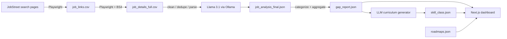

# UDiff — University Diff

> **Status:** Working prototype, **pending polish/rework** (see `Milestones and Logs.md`).
> **One-line pitch:** A data pipeline + dashboard that measures the gap between what universities teach and what the Malaysian tech job market actually demands.

---

## 1. Problem statement

University curricula move slowly; the job market does not. A final-year student has no data-driven way to answer "which skills does a Backend / AI / Frontend role actually demand right now in Malaysia, and how much of that does my degree cover?" Job postings are unstructured, scattered across pages, and full of noise (sponsored repeats, hidden salaries, vague titles). Turning them into a clean, comparable view of market demand requires scraping, LLM extraction, and aggregation — which is exactly what UDiff automates.

## 2. Aim

Build and deploy an end-to-end system that:

1. **Harvests** real job postings from a job board for a fixed set of role queries.
2. **Extracts** structured skills from each free-text posting using a local LLM (hard skills, soft skills, *technical context*, and experience level).
3. **Aggregates** the results into a "market gap report" — top skills, dominant technical contexts, and salary ranges — segmented by role and experience level.
4. **Presents** the findings through an interactive web dashboard, supplemented by gamified career roadmaps and a curriculum gap checker.

## 3. General idea — how UDiff works

The system is a **batch data pipeline** that feeds a **static web dashboard**. Data flows one way:

| Step | Module | Input → Output | What it does |
|---|---|---|---|
| 1. Scrape links | `pipeline/src/scraper.py` | JobStreet → `job_links.csv` | For each search query (10 role keywords), paginates results and collects title, company, location, salary, link |
| 2. Scrape details | `pipeline/src/scraper_details.py` | `job_links.csv` → `job_details_full.csv` | Visits each listing and extracts the full job description |
| 3. Extract skills | `pipeline/src/processor.py` | CSV → `job_analysis_final.json` | Cleans text, parses salary, normalizes location, de-duplicates (URL + content hash), then asks **Llama 3.1 8B** (Ollama, JSON mode) for `hard_skills`, `soft_skills`, `technical_context`, `experience_level` |
| 4. Analyze market | `pipeline/src/analyzer.py` | JSON → `gap_report.json` | Buckets job titles into role categories via keyword heuristics; aggregates top skills/contexts and salary stats per category × experience level |
| 5. Curriculum generator | `pipeline/src/curriculum_generation.py` | `gap_report.json` → `skill_class.json` | For each category's top skills, asks the LLM to generate plausible university course names → a skill→course synonym dictionary |
| 6. Dashboard | `web/` (Next.js) | JSONs → website | Renders the gap report, career roadmaps, and curriculum checker |

Supporting files:
- `pipeline/src/pipeline.py` — orchestrator that chains steps 1–4 as subprocesses (note: it does **not** yet include step 5).
- `pipeline/src/inspect_others.py` — dev utility that prints unclassified job titles (helps tune the category heuristics).
- `pipeline/legacy/dashboard.py` — **retired** Streamlit dashboard (superseded by the Next.js web app).

## 4. Expected outcome

- A **live, interactive dashboard** showing, for each role and experience level, the most in-demand hard skills, the technical contexts they appear in, and average salary ranges.
- **Gamified career roadmaps** (foundation → core → advanced) for 15+ roles.
- A **curriculum gap checker** that maps course/skill keywords to market demand via a pre-computed synonym dictionary.
- A reusable, explainable dataset of Malaysian tech job-market demand (a point-in-time snapshot).

## 5. Limitations (honest)

- **Scraper fragility:** depends on JobStreet's current DOM and automation attributes; selectors will break when the site changes. Single-threaded with fixed delays → slow, and requires a visible (non-headless) browser.
- **Point-in-time data:** the dataset is a snapshot; there is no scheduler or live refresh.
- **No ground truth for LLM extraction:** skill/context extraction is prompt-based and unvalidated; quality varies per posting. Category assignment is keyword heuristics and is brittle (see `inspect_others.py`).
- **Salary sparsity:** many postings hide salary, so salary averages are noisy.
- **`skill_class.json` is synthetic:** its course names are LLM-generated, not scraped from real university curricula — treat it as illustrative, not authoritative.
- **Matching is lexical, not semantic:** the curriculum checker uses keyword/synonym matching, not embeddings.
- **Code quality:** mixed human + AI-assisted code, **needs a refactor**. Notably, scripts resolve paths from `os.getcwd()` (they must be run from the repo root) and hard-code folder names; there are no tests and limited error handling.
- **License:** the pipeline was previously GPLv3 (`pipeline/LICENSE-GPLv3.txt`); the merged repo carries an MIT `LICENSE`. This must be reconciled by the owner.
