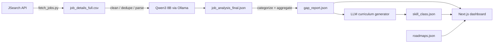

# UDiff — University Diff

> **Status:** Working prototype, **pending polish/rework** (see `Milestones and Logs.md`).
> **One-line pitch:** A data pipeline + dashboard that measures the gap between what universities teach and what the Malaysian tech job market actually demands.

---

## 1. Problem statement

University curricula move slowly; the job market does not. A final-year student has no data-driven way to answer "which skills does a Backend / AI / Frontend role actually demand right now in Malaysia, and how much of that does my degree cover?" Job postings are unstructured, scattered across pages, and full of noise (sponsored repeats, hidden salaries, vague titles). Turning them into a clean, comparable view of market demand requires scraping, LLM extraction, and aggregation — which is exactly what UDiff automates.

## 2. Aim

Build and deploy an end-to-end system that:

1. **Harvests** real job postings from a job board for a fixed set of role queries.
2. **Extracts** structured skills from each free-text posting using a local LLM (hard skills, soft skills, *technical context*, and experience level).
3. **Aggregates** the results into a "market gap report" — top skills, dominant technical contexts, and salary ranges — segmented by role and experience level.
4. **Presents** the findings through an interactive web dashboard, supplemented by gamified career roadmaps and a curriculum gap checker.

## 3. General idea — how UDiff works

The system is a **batch data pipeline** that feeds a **static web dashboard**. Data flows one way:

| Step | Module | Input → Output | What it does |
|---|---|---|---|
| 1. Fetch jobs | `pipeline/src/fetch_jobs.py` | JSearch API → `job_links.csv`, `job_details_full.csv` | Queries the JSearch API (OpenWebNinja, "Google for Jobs") per role keyword; maps title, company, location, salary, link and the full description; de-duplicates by job id |
| 2. Extract skills | `pipeline/src/processor.py` | CSV → `job_analysis_final.json` | Cleans text, parses salary, normalizes location, de-duplicates (URL + content hash), then asks **Qwen3 8B** (Ollama, JSON mode) for `hard_skills`, `soft_skills`, `technical_context`, `experience_level` |
| 3. Analyze market | `pipeline/src/analyzer.py` | JSON → `gap_report.json` | Buckets job titles into role categories via keyword heuristics; aggregates top skills/contexts and salary stats per category × experience level |
| 4. Curriculum generator | `pipeline/src/curriculum_generation.py` | `gap_report.json` → `skill_class.json` | For each category's top skills, asks the LLM to generate plausible university course names → a skill→course synonym dictionary |
| 5. Sync + dashboard | `pipeline/src/sync_web_data.py` + `src/` (Next.js) | JSONs → website | Copies the outputs into the app, which renders the gap report, roadmaps, and curriculum checker |

Supporting files:
- `pipeline/src/pipeline.py` — orchestrator that chains every step (fetch → extract → analyze → curriculum → sync) as subprocesses.
- `pipeline/src/config.py` — paths, settings, and the `.env` secret loader.
- `pipeline/src/inspect_others.py` — dev utility that prints unclassified job titles (helps tune the category heuristics).

## 4. Data

What the dashboard surfaces and how each view is meant to be used. Rows marked `*` are produced by **M5.6** (data enrichment); `†` by **M5.7** (SEA expansion — MY, SG, ID, VN). Unmarked rows are live today.

| Data / comparison | Data type | Chart type | Aim of data |
|---|---|---|---|
| Top hard skills (per role × level) | ranked categorical + % | horizontal bar | Most-demanded technologies for a role |
| Technical context / domains | weighted categories | treemap | Which application areas skills are used in (NLP, Android, Spring…) |
| Soft skills `*` | ranked list + count/% | bar / chips | Non-technical demand (communication, ownership) |
| Job distribution by role | category counts | bar / donut | Market composition — which roles have the most openings |
| Experience split (All / Junior / Mid / Senior) | ordinal buckets | stacked bar | Demand by seniority, incl. junior-market size |
| Jobs by state `*` | geographic category | bar / choropleth | Where hiring is concentrated (KL, Selangor, Penang…) |
| Top hiring companies `*` | ranked category + `kind` flag | bubble map (toggle placeholders) | Who is hiring; recruiter/confidential share |
| Salary estimate — nominal (MYR) | range per role × level | range / box bar | Market pay bands (estimated, attributed) |
| Salary estimate — PPP-adjusted (MYR) | range per role × level | dual range bar | Real purchasing power (cost-of-living adjusted) |
| Observed salary mentions `*` | sparse per-posting values | scatter / histogram | Best-effort observed-pay signal from ad text |
| Distinct skills `*` | scalar | metric card | Breadth of demand for a role |
| Posting recency `*` | time series | line / bar | Data freshness ("% posted in last 30 days") |
| Curriculum skill→course map | lookup dictionary | table / checker UI | Match a syllabus against demanded skills |
| Country skill gap (e.g. MY vs SG) `†` | signed deltas | diverging bar | Skills the local market is missing vs a peer |
| Country salary delta (nominal & PPP) `†` | signed deltas / ranges | dumbbell / diverging bar | Pay comparison between countries |
| Regional role distribution `†` | multi-category counts | grouped / stacked bar | Market composition across SEA |
| Career roadmaps | hand-authored phases | timeline / checklist | Guided learning path per role |

## 5. Expected outcome

- A **live, interactive dashboard** showing, for each role and experience level, the most in-demand hard skills, the technical contexts they appear in, and average salary ranges.
- **Gamified career roadmaps** (foundation → core → advanced) for 15+ roles.
- A **curriculum gap checker** that maps course/skill keywords to market demand via a pre-computed synonym dictionary.
- A reusable, explainable dataset of Malaysian tech job-market demand (a point-in-time snapshot).

## 6. Limitations (honest)

- **Data source:** postings come from the **JSearch API** (a Google-for-Jobs aggregator); coverage, and especially salary fields, depend on it — salary is frequently absent.
- **Point-in-time data:** the dataset is a snapshot; there is no scheduler or live refresh.
- **No ground truth for LLM extraction:** skill/context extraction is prompt-based and unvalidated; quality varies per posting. Category assignment is keyword heuristics and is brittle (see `inspect_others.py`).
- **Salary sparsity:** many postings hide salary, so salary averages are noisy.
- **`skill_class.json` is synthetic:** its course names are LLM-generated, not scraped from real university curricula — treat it as illustrative, not authoritative.
- **Matching is lexical, not semantic:** the curriculum checker uses keyword/synonym matching, not embeddings.
- **Code quality:** mixed human + AI-assisted code. Paths were centralised in `pipeline/src/config.py` (M2) and the orchestrator repaired (M3); there are still no automated tests.
